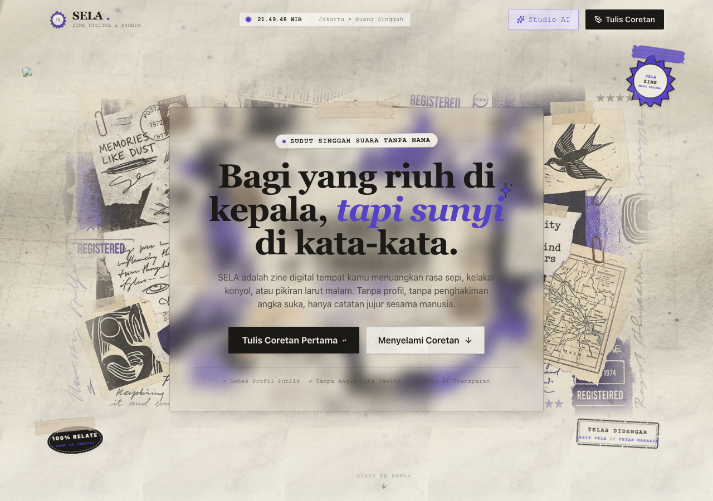

# koma,

**Tempat buat bilang hal-hal yang selama ini cuma ada di kepala.** Koma adalah ruang berbagi teks bergaya zine digital: pengunjung dapat membaca, menulis tanpa nama publik, dan menanggapi cerita orang lain tanpa membuat akun. Anonim bagi pembaca, tetapi tetap ada penanda sesi internal untuk kepemilikan tulisan dan pencegahan penyalahgunaan.

> Repositori ini adalah implementasi yang sedang dikembangkan. Gunakan kode dan konfigurasi aktual sebagai acuan saat menyiapkan lingkungan produksi; dokumen riset di `docs/riset/` memuat arah produk, bukan daftar fitur yang seluruhnya sudah selesai.



## Isi README

- [Yang sudah tersedia](#yang-sudah-tersedia)
- [Teknologi dan struktur proyek](#teknologi-dan-struktur-proyek)
- [Menjalankan secara lokal](#menjalankan-secara-lokal)
- [Konfigurasi lingkungan](#konfigurasi-lingkungan)
- [Database dan penyimpanan](#database-dan-penyimpanan)
- [Rute utama](#rute-utama)
- [Pengujian](#pengujian)
- [Persiapan deployment](#persiapan-deployment)
- [Keamanan dan batasan](#keamanan-dan-batasan)
- [Kontribusi](#kontribusi)

## Yang sudah tersedia

- **Coretan publik:** menulis sebagai `Tanpa Nama` atau nama samaran, memilih `Boleh Dibalas` / `Cukup Didengar`, menjelajah berdasarkan filter/topik, membuka permalink, serta menyunting atau menghapus coretan dengan sesi/kunci penulis.
- **Interaksi:** balasan, reaksi non-kompetitif, dan pelaporan konten kepada pengelola.
- **Moderasi:** aturan teks dan antrean tinjauan admin. Jika provider moderasi AI tidak tersedia, konten baru dapat ditahan untuk ditinjau, bukan otomatis dinyatakan aman.
- **Studio inspirasi tulisan:** saran AI ketika provider dikonfigurasi; tersedia bank saran kurasi saat provider tidak tersedia. Saran tidak diterbitkan otomatis.
- **Gambar pendamping coretan:** upload melalui Vercel Blob **hanya jika** token Blob, rahasia penandatanganan, dan provider pemeriksaan gambar/vision dikonfigurasi. Gambar yang belum lolos pemeriksaan tidak dipublikasikan.
- **Pesan privat ke pengelola:** formulir `/pesan` tanpa nama atau email; admin melihat pesan di kotak masuk dan dapat menandainya sudah dibaca. **Tidak ada fitur membalas pesan** melalui formulir ini dan pesan bukan DM antarpengguna.
- **Dashboard admin:** ringkasan aktivitas, analitik dari data yang tersedia, manajemen coretan, laporan, aturan moderasi, status AI, pengaturan dukungan, pesan pengunjung, dan status sistem.
- **Kanal dukungan:** halaman donasi yang dapat diatur atau dinonaktifkan admin.

Tampilan mobile: [lihat tangkapan layar](docs/screenshots/landing/screenshot-mobile.png). Arsip bukti tampilan lain ada di [`docs/screenshots/`](docs/screenshots/README.md).

## Teknologi dan struktur proyek

Implementasi saat ini menggunakan **Next.js 14 App Router**, **React 18**, **TypeScript**, **Tailwind CSS 3**, **Zod**, dan **Drizzle ORM** dengan PostgreSQL (`@vercel/postgres`). Jangan menganggap proposal stack di dokumen riset (misalnya Fastify/Prisma/Redis) sudah dipakai oleh aplikasi ini.

```text
src/
├── app/                 # Halaman App Router dan route handler /api
├── components/          # Komponen publik, feed, dan dashboard admin
├── db/                  # Skema Drizzle dan inisialisasi tabel PostgreSQL
├── lib/                 # Penyimpanan, sesi, validasi, moderasi, dan integrasi
└── types/               # Tipe data aplikasi (src/types/index.ts)
drizzle/                 # SQL migrasi/skema untuk ditinjau saat deployment
public/                  # Identitas visual, aset, manifest/PWA
tests/                   # Pengujian moderasi, integrasi, dan admin
docs/                    # Riset dan tangkapan layar
```

## Menjalankan secara lokal

Prasyarat: Node.js dan npm yang kompatibel dengan Next.js 14, serta PostgreSQL **bila ingin menguji penyimpanan persisten**. Tanpa koneksi database, mode pengembangan memakai file JSON lokal.

```bash
git clone <URL_REPOSITORI_ANDA>
cd <NAMA_FOLDER_REPOSITORI>
npm ci
```

Buat `.env.local` di root dengan **nilai milikmu sendiri**. Lihat [konfigurasi](#konfigurasi-lingkungan) sebelum menyalin `.env.example`—file contoh mengandung URL/kunci dummy yang tidak akan bekerja sebagai kredensial. Untuk mencoba tampilan dan data lokal tanpa database, jangan isi variabel koneksi PostgreSQL dengan nilai dummy.

```bash
npm run dev
```

Buka `http://localhost:3000`. Area pengelola ada di `http://localhost:3000/admin` dan **tidak dapat diakses** sampai `ADMIN_PASSWORD` yang kuat disetel di environment server. Untuk menjalankan hasil build:

```bash
npm run build
npm run start
```

> Build tanpa `ADMIN_PASSWORD` dapat menampilkan log penolakan akses admin. Itu adalah perilaku *fail-closed*; jangan memperbaikinya dengan password default di kode.

## Konfigurasi lingkungan

Semua kunci/password bersifat **server-side**. Jangan menggunakan prefiks `NEXT_PUBLIC_` untuk rahasia, memasukkan nilai sungguhan ke `.env.example`, atau meng-commit `.env.local`.

| Variabel | Kegunaan | Kapan diperlukan |
| --- | --- | --- |
| `ADMIN_PASSWORD` | Kata sandi dashboard `/admin`. Tanpa nilai, akses admin ditolak. | Wajib untuk mengakses admin. |
| `POSTGRES_URL` | Koneksi PostgreSQL; kode juga mendeteksi `DATABASE_URL` / `POSTGRES_PRISMA_URL`. | Wajib untuk pesan pengelola di produksi; direkomendasikan untuk seluruh data produksi. |
| `AI_API_KEY`, `AI_MODEL` | Provider kompatibel OpenAI untuk studio saran; juga dapat dipakai moderasi teks bila variabel khusus tidak diatur. | Opsional untuk studio; tanpa moderasi yang tersedia konten teks dapat menunggu tinjauan. |
| `AI_BASE_URL` | Endpoint provider Studio AI yang kompatibel dengan chat completions. | Jika provider/model gagal, Studio mengembalikan error; tidak menyajikan contoh statis sebagai hasil AI. |
| `AI_MODERATION_API_KEY`, `AI_MODERATION_MODEL`, `AI_MODERATION_BASE_URL` | Provider khusus moderasi teks. | Bila memakai provider moderasi yang berbeda dari studio. |
| `BLOB_READ_WRITE_TOKEN`, `IMAGE_UPLOAD_SIGNING_SECRET` | Penyimpanan gambar di Vercel Blob dan pengikatan hasil upload ke sesi. | Diperlukan bersama pemeriksaan gambar agar upload tersedia. |
| `AI_IMAGE_MODERATION_API_KEY`, `AI_IMAGE_MODERATION_MODEL`, `AI_IMAGE_MODERATION_BASE_URL` | Pemeriksaan konten gambar dan model vision; kunci dapat memakai variabel moderasi/AI umum jika dikonfigurasi. | Upload gambar membutuhkan model vision yang mendukung chat completions dengan input gambar dan balasan JSON. |
| `AI_IMAGE_API_KEY`, `AI_IMAGE_MODEL`, `AI_IMAGE_BASE_URL` | Provider terpisah untuk generasi gambar di integrasi AI. | Opsional, sesuai fitur/provider yang digunakan. |

Rujukan variabel lain: [`.env.example`](.env.example). Untuk penyedia layanan apa pun, gunakan kredensial asli dari layanan tersebut **hanya di environment server**. Jangan menaruh fallback kredensial di source code.

## Database dan penyimpanan

- **Pengembangan tanpa PostgreSQL:** aplikasi menyimpan data di `.local-koma-db.json` (diabaikan oleh Git). Saat file belum ada, penyimpanan lokal dibuat dengan contoh coretan awal. **Data contoh itu bukan aktivitas pengguna riil.** Jangan gunakan file ini untuk data sensitif atau menganggapnya penyimpanan produksi.
- **Dengan PostgreSQL:** setel URL koneksi yang valid. Skema ada di `src/db/schema.ts`; `src/db/index.ts` membuat tabel yang belum ada saat jalur penyimpanan memerlukannya. SQL terkait ada di `drizzle/` untuk peninjauan/perubahan skema deployment. Pastikan role database memiliki izin yang sesuai untuk pembuatan tabel saat awal dijalankan; kelola perubahan skema produksi secara terkontrol.
- **Khusus pesan admin:** pada produksi tanpa PostgreSQL, endpoint pengiriman/inbox menolak operasi agar tidak mengklaim pesan berhasil disimpan ke filesystem ephemeral. Di pengembangan, pesan dapat memakai file JSON lokal.
- **Rate limit:** sebagian pembatasan memakai memori proses, sehingga tidak menjadi pembatas global yang kuat di banyak instance. Pesan memiliki pemeriksaan batas tambahan berdasarkan sesi di penyimpanan. Untuk situs publik berskala besar, tambahkan perlindungan abuse di infrastruktur sebelum peluncuran.

Jangan membagikan `.local-koma-db.json`, connection string, atau salinan data pesan ketika membuat issue atau PR.

## Rute utama

| Halaman | Fungsi |
| --- | --- |
| `/` | Beranda, alur menulis, dan feed. |
| `/jelajah` | Jelajah coretan. |
| `/coretan/[id]` | Detail/permalink coretan. |
| `/tentang`, `/aturan`, `/privasi` | Penjelasan ruang, aturan, dan kebijakan privasi. |
| `/dukung` | Kanal dukungan (dapat dinonaktifkan admin). |
| `/pesan` | Kirim pesan privat ke pengelola. |
| `/admin` | Dashboard pengelola dengan autentikasi. |

Route handler ada di `src/app/api/`. Contoh: `/api/posts` untuk coretan, `/api/messages` untuk pengiriman pesan, dan `/api/admin/messages` untuk inbox/penandaan baca yang dilindungi autentikasi admin. Jangan gunakan endpoint admin dari klien publik.

## Pengujian

```bash
npx tsc --noEmit       # Pemeriksaan tipe
npm test                # Moderasi teks dan keamanan gambar
npm run test:all        # Tambahan integrasi core dan suite admin
npm run build           # Build produksi
```

Script tersedia juga sebagai `test:moderation`, `test:image`, `test:integration`, dan `test:admin`. Lihat [`tests/README.md`](tests/README.md). **Perhatian:** beberapa pengujian integrasi/admin menggunakan dan mengubah penyimpanan lokal. Jalankan pada lingkungan uji/disposable, bukan terhadap database produksi atau file data pribadi. Suite otomatis belum menjamin semua alur UI; tetap periksa desktop dan mobile sebelum deploy.

## Persiapan deployment

Aplikasi dapat dibangun dengan `npm run build` dan dijalankan dengan `npm run start` pada host Node.js. Sebelum menerima data pengguna sungguhan:

1. Sediakan PostgreSQL persisten dan setel URL koneksi di environment server; pastikan pembuatan/upgrade tabel berhasil. Jangan memakai file JSON lokal pada deployment multi-instance/serverless.
2. Setel `ADMIN_PASSWORD` kuat yang unik melalui pengaturan rahasia host, bukan di repositori. Siapkan HTTPS, batasi akses jaringan ke area admin bila memungkinkan, dan uji logout serta penolakan akses tanpa login.
3. Setel provider moderasi teks jika ingin coretan bisa langsung melewati alur pemeriksaan otomatis; tanpa provider, konten ditahan untuk tinjauan. Jika mengaktifkan upload, **semua** konfigurasi Blob, signing secret, dan moderasi gambar/vision harus bekerja.
4. Cek halaman `/`, `/jelajah`, `/pesan`, dan `/admin` di perangkat mobile serta desktop. Uji satu pesan masuk dan terlihat di admin; tanpa PostgreSQL produksi, fitur pesan memang harus gagal secara jujur.
5. Evaluasi kebijakan privasi, retensi data pesan, backup/restore, perlindungan spam global, dan pengamanan autentikasi sebelum peluncuran publik. Jangan kirim data pengguna ke layanan pihak ketiga tanpa pemberitahuan yang memadai.

README ini **bukan** pernyataan bahwa aplikasi sudah melalui audit keamanan atau siap dipakai untuk data sensitif. Tidak ada konfigurasi deployment otomatis yang diasumsikan di sini.

## Keamanan dan batasan

- `ADMIN_PASSWORD` **tidak memiliki nilai default**. Jika kosong/tidak disetel, verifikasi admin menolak akses. Implementasi saat ini memakai kecocokan password sederhana dan menyimpan nilainya di cookie `HttpOnly` setelah login; ini **bukan** sistem sesi admin berotasi. Sebelum deployment publik, prioritaskan hardening autentikasi (sesi server-side/berumur pendek, pembatasan percobaan login, CSRF) serta HTTPS dan rahasia kuat.
- Sesi pengunjung memakai cookie anonim `HttpOnly`, dengan `SameSite=Lax` dan `Secure` pada produksi. Anonim berarti tidak menampilkan identitas kepada publik, **bukan** tanpa penanda internal.
- Pengiriman pesan admin membatasi panjang 10–2000 karakter dan, dalam implementasi saat ini, maksimum tiga pesan per jam per sesi; pesan tidak dipublikasikan. Jangan kirim kata sandi atau informasi pribadi yang tidak perlu.
- Konten teks/gambar dapat dikirim ke provider AI yang **dikonfigurasi operator** untuk pemeriksaan atau bantuan penulisan. Tinjau kebijakan data provider sebelum mengaktifkannya.
- Saat provider pemeriksaan gambar/konfigurasinya tidak tersedia, upload ditolak (*fail closed*). Saat moderasi teks otomatis tidak tersedia, coretan/balasan dapat ditahan untuk tinjauan admin.
- Tidak ada percakapan privat antarpengguna, janji balasan admin lewat formulir pesan, atau jaminan bahwa semua klaim dan target di dokumen riset sudah terimplementasi.

## Kontribusi

Issue dan pull request dipersilakan. Sebelum mengirim perubahan, jalankan pemeriksaan tipe, pengujian yang relevan, dan build; jaga privasi teks pengunjung dan jangan sertakan dump database maupun rahasia environment. Untuk arah produk, baca [`PRODUCT.md`](PRODUCT.md) dan [`docs/riset/`](docs/riset/README.md).

**Lisensi:** repositori ini belum menyertakan berkas `LICENSE`. Keberadaan kode di GitHub tidak otomatis memberi izin penggunaan ulang/distribusi; hubungi pemilik proyek jika membutuhkan izin tersebut.
