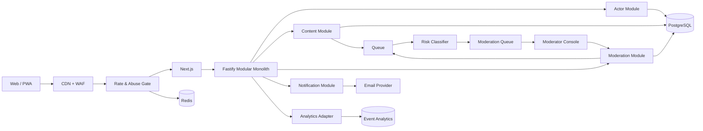
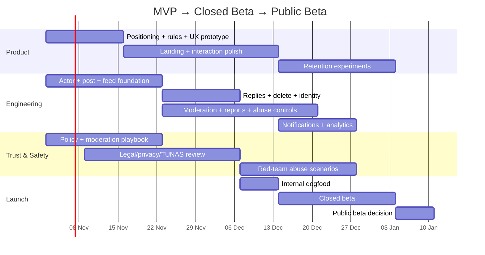

# Rancangan dan Strategi Peluncuran Platform “Ruang Nongkrong” Teks

## Ringkasan eksekutif

Positioning yang lebih kuat untuk produk ini adalah:

> **Ruang nongkrong digital buat mengatakan hal-hal yang biasanya cuma ada di kepala.**

Orang boleh curhat, ngomel, bertanya, bercerita soal kerjaan, cinta, keluarga, kegagalan, kemenangan kecil, opini receh, keresahan, atau sekadar meninggalkan satu kalimat pukul dua pagi. Produk tidak menjanjikan terapi dan tidak mengharuskan setiap tulisan menjadi “deep”.

Tesis produknya:

> **low identity pressure + public expression + human response + strong user control**

Anonimitas memang dapat menurunkan tekanan identitas dan membantu disclosure, tetapi psychological safety dan relevansi personal sangat menentukan apakah orang bertahan; moderasi aktif juga dapat meningkatkan engagement dan mengurangi perilaku buruk. Karena itu desain yang tepat bukan “semua bebas karena anonim”, tetapi:

> **anonim terhadap publik, accountable terhadap sistem.**

Secara konkret, user publik bisa muncul sebagai `tanpa nama` atau alias, tetapi backend tetap memiliki `actor_id` privat untuk ownership, delete, rate limit, abuse history, dan moderation. Tellonym sendiri membedakan anonimitas terhadap pengguna lain dari disclosure kepada aparat ketika ada dasar hukum; ini model mental yang jauh lebih jujur daripada janji “100% tidak bisa dilacak”.

Keputusan produk yang paling tepat untuk MVP:

| Area | Rekomendasi |
|---|---|
| Positioning | Ruang ekspresi publik / digital hangout, **bukan aplikasi terapi dan bukan confession app** |
| Landing page | Landing page **langsung merupakan feed + composer** |
| Membaca | Tanpa akun |
| Mulai menulis | Tanpa akun dan tanpa onboarding di depan |
| Publish pertama | Baru tampilkan eligibility + tiga aturan singkat |
| Public identity | `tanpa nama` default; alias opsional |
| Internal identity | Stable opaque `actor_id` |
| Social graph | Tidak ada follower/following di MVP |
| Likes | Tidak ada like-score |
| Acknowledgement | Satu aksi seperti **“aku dengerin”**, tanpa ranking popularitas |
| Percakapan | Reply thread dangkal, maksimal sekitar dua level |
| Kontrol OP | `boleh dibalas` atau `cukup didengar` |
| Discovery | `terbaru`, `belum dibalas`, `acak`, `topik`; **bukan viral/trending dulu** |
| Sharing | Public permalink, tetapi UGC `noindex` secara default |
| Moderasi | Rule engine + risk classifier + human review |
| Retensi | Reply, unfinished conversation, unanswered-post matching, digest; bukan streak |
| Launch audience | Memulai dari **16+**, dengan legal review khusus PP TUNAS sebelum beta publik |
| Architecture | Modular monolith; Next.js + Fastify + Prisma + PostgreSQL + Redis + Cloudflare |
| North Star | Persentase tulisan yang mendapatkan **respons sehat**, bukan DAU semata |

North Star yang disarankan:

$$\text{Supported Coretan Rate}_{24h} = \frac{\text{coretan baru yang memperoleh } \ge 1 \text{ balasan sehat dalam 24 jam}}{\text{seluruh coretan baru yang dapat dibalas}}$$

Bukan *"berapa banyak orang scroll?"*, melainkan:

> **“berapa banyak orang yang datang mengatakan sesuatu lalu benar-benar merasa ada manusia di sisi lain?”**

---

## Positioning, Identitas, & Benchmark Kompetitor

### Arsitektur Identitas Bertingkat
```text
                    INTERNAL
             ┌──────────────────┐
             │ actor_id: A91F…  │
             │ risk state       │
             │ ownership        │
             │ moderation hist. │
             └────────┬─────────┘
                      │
          ┌───────────┴──────────┐
          ▼                      ▼
    PUBLIC POST A           PUBLIC POST B

     tanpa nama                 senja
     no profile link            optional alias
     no history link            pseudonymous
```
Dalam sebuah thread, sistem dapat memberikan kontinuitas lokal:
```text
tanpa nama (OP)
orang 17
orang 42
orang 17
```
`orang 17` hanya konsisten **di thread tersebut**, bukan menjadi profil global permanen.

---

## Wireframe & Alur Interaksi

### Desktop Wireframe
```text
┌─────────────────────────────────────────────────────────────────┐
│ coret.                                    tentang   aturan   ○   │
│                                                     night mode   │
├─────────────────────────────────────────────────────────────────┤
│                                                                 │
│                    ada yang pengin kamu keluarin?               │
│                                                                 │
│         gak harus penting. gak harus rapi. tulis aja.           │
│                                                                 │
│    ┌──────────────────────────────────────────────────────┐     │
│    │ yang lagi numpuk di kepala...                       │     │
│    │                                                      │     │
│    │                                                      │     │
│    │                                                      │     │
│    │ tanpa nama ▾                          coret di sini → │     │
│    └──────────────────────────────────────────────────────┘     │
│                                                                 │
│       boleh tanpa nama · bisa dihapus · jaga privasi orang     │
│                                                                 │
├─────────────────────────────────────────────────────────────────┤
│  138 orang lagi nongkrong                                      │
│                                                                 │
│  [ terbaru ] [ belum dibalas ] [ acak ]   hidup  kerja  cinta │
│                                                                 │
│    ┌──────────────────────────────────────────────────────┐     │
│    │ tanpa nama · 8 menit lalu                           │     │
│    │                                                      │     │
│    │ akhir-akhir ini aku ngerasa semua orang bergerak     │     │
│    │ maju dan aku masih ada di tempat yang sama.          │     │
│    │                                                      │     │
│    │ ◯ aku dengerin             7 balasan                 │     │
│    └──────────────────────────────────────────────────────┘     │
│                                                                 │
│    ┌──────────────────────────────────────────────────────┐     │
│    │ senja · 17 menit lalu                               │     │
│    │                                                      │     │
│    │ tadi beli gorengan dikasih bonus satu. ternyata      │     │
│    │ sesimpel itu cukup buat bikin hariku agak mendingan. │     │
│    │                                                      │     │
│    │ ◯ aku dengerin             3 balasan                 │     │
│    └──────────────────────────────────────────────────────┘     │
│                                                                 │
│                   ↓ lihat apa lagi yang kepikiran orang        │
└─────────────────────────────────────────────────────────────────┘
```

### Mekanisme Redistribusi Respons (*Listener Supply*)
Jangan merangking berdasarkan `reply_count DESC` karena menyebabkan situasi "yang ramai makin ramai". Setelah pengguna menerbitkan tulisan, tampilkan:
> **sudah keluar.**
> sambil nunggu, ada seseorang yang belum dibalas.

Alur perputaran ini mengubah pengunjung dari sekadar penuntut empati (*speaker*) menjadi penyedia empati (*listener*).

---

## Arsitektur Teknis & Model Data

### Arsitektur Modular Monolith


### Keamanan Sesi & Anonymous Delete
* `actor_id` kriptografis disimpan di database dan dienkripsi dalam cookie `HttpOnly`, `Secure`, `SameSite=Lax`.
* Saat menerbitkan coretan, klien menghasilkan `delete_secret` acak. Server hanya menyimpan `hash(delete_secret)`. Klien dapat menghapus tulisan tanpa perlu akun.

---

## Roadmap Peluncuran 12 Minggu



### Prioritas Lingkup MVP:
* **Wajib Ada:** Landing/feed publik, anonymous actor, tulis teks, balasan dangkal (maks depth 2), kontrol balasan OP (`boleh dibalas`/`cukup didengar`), hapus mandiri via token, permalink `noindex`, feed `terbaru`/`belum dibalas`/`acak`, laporan pengguna, blokir/senyapkan aktor, konsol moderator internal, rate limiting & Cloudflare Turnstile, triage risiko teks, penanganan krisis Healing119, kepatuhan UU PDP & batasan usia 16+.
* **Dilarang Masuk MVP:** DM, followers, quote post, repost, public like count, karma, leaderboard trending, streak harian, upload gambar/video, AI chat companion.
